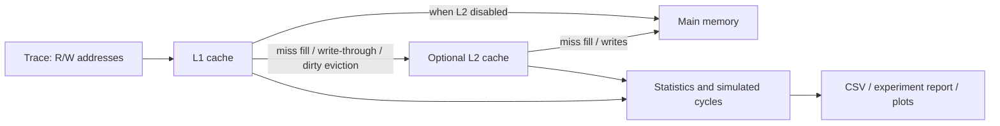

# Cache simulator

A C++17 cache simulator for investigating how memory-access patterns affect cache performance. Supports direct-mapped, N-way set-associative, and fully associative caches; FIFO/LRU replacement; four write/allocation combinations; and an optional L2 cache.

Reports hit/miss rates, compulsory/capacity/conflict misses, dirty writebacks, memory transactions, and simulated average access time. Includes executed C++ workloads, reproducible configuration sweeps, plots, and a Python reference model.

## Quick start

Requires `g++`, Make, and Python 3. Core simulation, experiments, and tests use no Python packages.

```bash
make
make traces
make test
./cache_sim --trace traces/loop.txt --compare --csv results.csv
```

Example (1 KiB cache, 16-byte blocks):

```text
Organization          Policy  Hit ratio Miss ratio  Compulsory    Capacity    Conflict        AMAT
Direct Mapped         LRU        99.61%      0.39%          32           0           0        1.39
  Memory reads/writes: 32/0; L1 writebacks: 0; pending dirty: 0
```

`--compare` prints FIFO and LRU rows for direct mapping, 2-way, 4-way, and fully associative configurations. AMAT is in simulated cycles, not execution time on your computer.

## Workload experiments and graphs

```bash
make experiments
# Outputs artifacts/sweep.csv, artifacts/report.md, and artifacts/traces/
```

The experiment executes ordinary and blocked matrix multiplication, array traversal, and shuffled linked-list traversal. It checks computation checksums, then evaluates 15 configurations per workload: cache size, block size, associativity, replacement, write policies, and a hierarchy example. Sweeps vary one factor at a time; they are not an exhaustive search for a universal best cache.

Optional plots use Matplotlib in a local environment:

```bash
python3 -m venv .venv
.venv/bin/python -m pip install -r requirements.txt
make plots PYTHON=.venv/bin/python
```

This produces PNG and SVG plots for cache size, block size, and associativity, showing miss rates and AMAT. See [the checked-in experiment report](docs/EXPERIMENTS.md) for measured results and interpretation. Generated traces and local artifacts are ignored by Git.

## Options

| Option | Meaning | Default |
|---|---|---|
| `--trace FILE` | Memory trace; required | — |
| `--size BYTES` | L1 capacity; power of two | 1024 |
| `--block BYTES` | Shared cache block size; power of two | 16 |
| `--assoc N` | 1 = direct mapped, N = N-way, 0 = fully associative | 1 |
| `--policy LRU\|FIFO` | L1 replacement policy | LRU |
| `--write-policy WB\|WT` | Write-back or write-through; applies to both levels | WB |
| `--allocation WA\|NWA` | Write-allocate or no-write-allocate; both levels | WA |
| `--hit-time CYC` | L1 lookup latency | 1 |
| `--miss-penalty CYC` | Main-memory latency per read or write transaction | 100 |
| `--l2-size BYTES` | Enable L2 with this capacity | disabled |
| `--l2-assoc N` | L2 associativity; 0 = fully associative | 4 |
| `--l2-policy LRU\|FIFO` | L2 replacement policy | LRU |
| `--l2-hit-time CYC` | L2 lookup latency | 10 |
| `--csv FILE` | Export one row per configuration; overwrite existing output | disabled |
| `--compare` | Compare L1 organizations and replacement policies | disabled |
| `--help` | Show usage | — |

Associativity must be zero or a power of two no greater than the line count. Each level must have capacity >= block size. L2 can be smaller than L1 because the model does not require inclusion. Explicit L2 options require `--l2-size`. Timing values must be finite and nonnegative.

```bash
# Two-level write-back cache
./cache_sim --trace artifacts/traces/matmul_blocked.txt \
  --size 4096 --block 64 --assoc 4 --write-policy WB --allocation WA \
  --l2-size 32768 --l2-assoc 8 --l2-hit-time 10 --csv results.csv

# Write-through without allocation on a write miss
./cache_sim --trace artifacts/traces/matmul_blocked.txt \
  --size 4096 --block 64 --assoc 4 --write-policy WT --allocation NWA
```

## Trace format and validation

One address per line, hexadecimal (`0x1A2B`) or decimal. An optional uppercase `R` or `W` specifies the operation; a bare address is a read. `#` starts a comment. Leading zeros in decimal values do not select octal.

```text
R 0x1000
W 0x1008
4096 # read
```

Each line models one access contained in its addressed block. There is no access-width field and no automatic splitting across block boundaries. Invalid addresses, extra tokens, unknown policies, overflowing integers, negative/nonfinite timings, and empty traces are rejected. Trace errors identify filename and line number. CSV output cannot alias the input trace, including via a symlink or hard link.

## Architecture and model



`number of sets = capacity / (block size × associativity)`. The simulator derives block number and set from each address; storing the full block number is equivalent to matching the address tag within that set. Valid lines are searched before replacement. Empty lines are filled first; FIFO evicts the oldest insertion and LRU evicts the least recent access.

The optional L2 is **non-inclusive and non-exclusive**: blocks can appear in both levels, and an L2 eviction does not invalidate L1. A dirty L1 copy can be newer than its L2 copy until written back. There is one CPU, no coherence protocol, and no data-value simulation. Both levels share block size, write policy, and allocation policy; capacities, associativities, replacement policies, and lookup latencies are independently configurable.

### Writes and memory traffic

- **WB:** a write hit marks the line dirty. Evicting a dirty line sends one full-block write to the next level.
- **WT:** every write sends a write to the next level; cached lines remain clean.
- **WA:** a write miss allocates a line, normally fetching its block first.
- **NWA:** a write miss bypasses that cache. A write hit still follows WB or WT.
- A full-block dirty writeback can allocate in the next level without reading the old block. A partial CPU write miss cannot skip that read under WA.
- Caches start empty. There is **no final flush**: pending dirty lines are reported at both levels. Traffic counts cover the trace interval, not eventual persistence of every write.

Memory traffic counts transactions, not bytes: reads fetch blocks, writes may be demand writes or whole dirty blocks. Those transactions have equal configured latency in this simplified model.

### Timing and ratios

Every lookup pays that level's hit time. Lower-level requests and dirty evictions are processed serially, and their costs are added. There are no write buffers, overlapping misses, prefetching, or bandwidth limits.

`AMAT = total simulated cycles / CPU accesses`.

For read-only single-level traces this reduces to `hit time + miss ratio × miss penalty`. Write-through traffic and dirty evictions add costs even if a simple miss-rate formula would not capture them. Read-only two-level AMAT is `L1 hit time + L1 miss ratio × (L2 hit time + L2 local miss ratio × memory time)`.

L2 local counts include all requests reaching L2, including L1 dirty evictions. **Global fill miss ratio** is memory block reads divided by CPU accesses; on read-only traces this is the usual global last-level miss rate. It excludes writes that bypass allocation and should not be interpreted as all memory traffic for write-heavy workloads.

### Miss classification

Each level has a same-capacity fully associative LRU reference that processes every request:

1. A miss on a never-seen block is compulsory.
2. A later miss is capacity if the LRU reference also misses.
3. Otherwise it is reported as conflict.

The three counts sum to misses. For FIFO or NWA targets, the conflict bucket also contains replacement/allocation-policy misses relative to the allocating LRU reference; it is not purely a placement diagnosis. Reference lookup occurs before updating the reference with the current request, including target hits and bypasses.

Target access costs O(associativity); reference updates average O(1). First-access tracking uses O(distinct blocks) memory, reference state O(cache lines), and trace loading O(trace length). The implementation favors clarity over simulator throughput.

## Verification

`make test` builds with `-Wall -Wextra` and runs:

- Small hand-calculated locality, replacement, and AMAT cases.
- Miss classification, CSV escaping/metrics, input validation, and file error cases.
- Hand-calculated write traffic and two-level latency cases.
- 48 seeded randomized comparisons against a separate list-based Python model, covering FIFO/LRU, direct/set/full associativity, all four write/allocation combinations, and one/two levels.
- Workload checksum checks and trace operation/count contracts.

Tests check access accounting, miss-category totals, dirty state, memory transactions, L2 counters, and simulated cycles. The Python model is a correctness cross-check of these stated assumptions, not validation against a hardware CPU.

## Trace provenance and limitations

`gen_trace.py` creates synthetic teaching patterns. The C++ workload runner executes actual computations and explicitly logs selected source-level accesses using deterministic logical addresses. It excludes initialization, compiler-generated accesses, stack traffic, instructions, and tracing overhead. These are **source-instrumented logical traces, not full binary/hardware captures**. Linked-list nodes are explicitly aligned and padded to 64 bytes; normalized base addresses and layout influence set conflicts. Results describe these traces and assumptions, not every compiled implementation of the workload.

A separately captured trace can be supplied in the documented R/W format, provided accesses spanning blocks are expanded appropriately. There is no bundled binary trace collector. The project also excludes coherence, TLBs, virtual-to-physical translation, variable access widths, and cycle-accurate CPU execution. Workload runtime is deliberately not reported as cache speedup.

## Layout

```text
cache_sim.cpp                  Cache model, hierarchy, trace parser, CLI, CSV
workloads/trace_workloads.cpp   Instrumented computation and traversal workloads
scripts/experiments.py         Sweeps, generated report, optional Matplotlib plots
gen_trace.py                   Synthetic teaching traces
tests/                         Regression and reference-model tests
docs/EXPERIMENTS.md             Checked-in reproducible findings
docs/DEMO.md                    Short interview demo
```

Developed with AI assistance. Results in the experiment report come from executing this repository's model; modeling assumptions and limits are stated explicitly.
