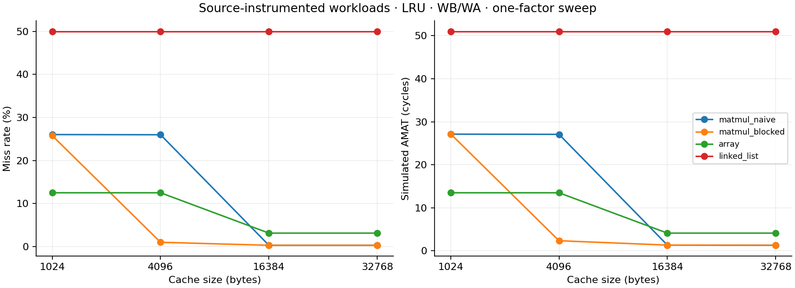
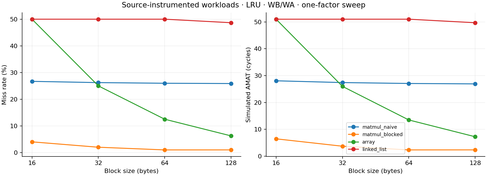
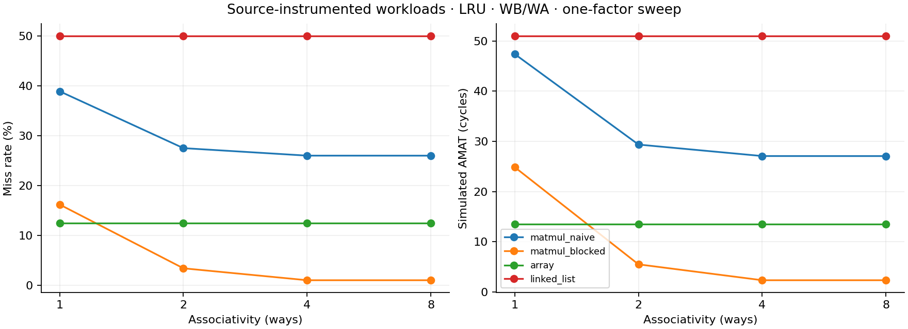

# Reproducible workload experiment

Run: `make experiments` (charts: `make plots PYTHON=.venv/bin/python`).

These are source-instrumented logical data traces from executed C++ computations, not hardware captures. Initialization, stack, instruction fetches, compiler transformations, and tracer operations are excluded. Addresses are normalized for reproducibility. All caches start cold; remaining dirty lines are not flushed.

Matrices: 32 × 32 doubles, 8 × 8 tiles, identical multiply/update operations and checked results. Traversal: 1,024 values, four passes; array elements are 8 bytes apart, linked-list logical nodes are 64 bytes apart in seeded shuffled order. This deliberately compares both layout and traversal, not just pointer overhead.

Baseline: 4 KiB, 64-byte blocks, 4-way LRU, WB/WA; hit 1 cycle, memory 100 cycles.

| Workload | Accesses | Miss rate | AMAT (cycles) | Memory reads | Memory writes |
|---|---:|---:|---:|---:|---:|
| matmul_naive | 131072 | 25.98% | 27.077 | 34056 | 124 |
| matmul_blocked | 131072 | 1.00% | 2.356 | 1308 | 469 |
| array | 4096 | 12.50% | 13.500 | 512 | 0 |
| linked_list | 8192 | 50.00% | 51.000 | 4096 | 0 |

At the baseline, blocking changes miss rate from 25.98% to 1.00%, and simulated AMAT from 27.077 to 2.356 cycles. Tiles reuse smaller portions of A, B, and C before moving on. Set conflicts can limit the benefit; cache capacity alone does not predict every result.

| Cache size | Naive miss rate | Blocked miss rate |
|---|---:|---:|
| 1024 B | 26.03% | 25.78% |
| 4096 B | 25.98% | 1.00% |
| 16384 B | 0.29% | 0.29% |
| 32768 B | 0.29% | 0.29% |

The total matrix working set is 24 KiB. The size sweep shows whether blocking still helps when that working set fits. The CSV also varies block size, associativity, replacement, write policy, and allocation independently; these are one-factor comparisons, not an exhaustive search.

## Write policies on blocked multiplication

| Policy | Allocation | AMAT | Memory reads | Memory writes | Pending L1 dirty lines |
|---|---|---:|---:|---:|---:|
| WB | WA | 2.356 | 1308 | 469 | 7 |
| WB | NWA | 2.356 | 1308 | 469 | 7 |
| WT | WA | 26.998 | 1308 | 32768 | 0 |
| WT | NWA | 26.998 | 1308 | 32768 | 0 |

## L1/L2 example

Naive multiplication with baseline L1 and a 32 KiB, 8-way LRU L2 (10-cycle lookup): L1 miss rate 25.98%, L2 local miss rate 1.12%, global fill miss ratio 0.29%, AMAT 3.901 cycles.

L2 local statistics include L1 dirty writebacks. Global fill miss ratio means memory block reads per CPU access, not write-bypass traffic. Latency is a serial blocking model; there are no write buffers, prefetching, bandwidth effects, or overlapping misses. These are simulated latencies, not measured program runtime or CPU speedups.

## Figures and raw data

The [raw results](sweep.csv) contain all 60 configurations. Trace paths are relative to the generated `artifacts/` directory. The figures below were generated from the same sweep.

